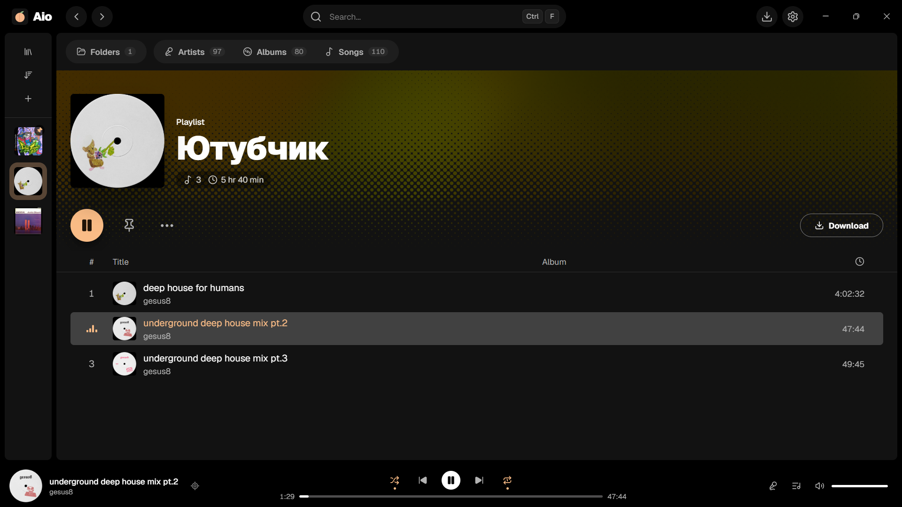
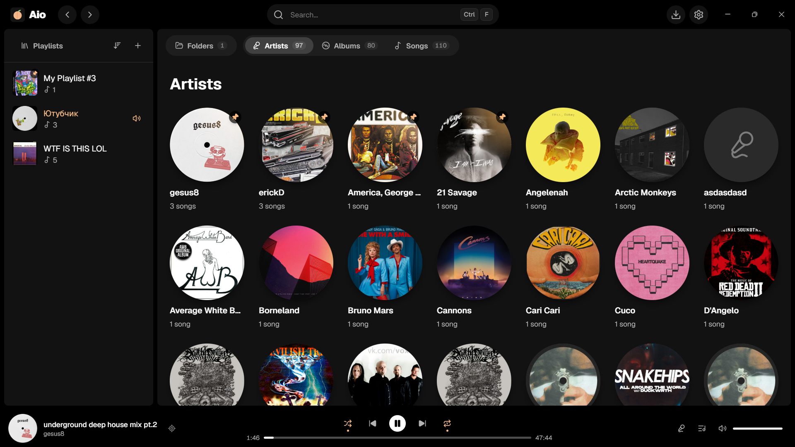
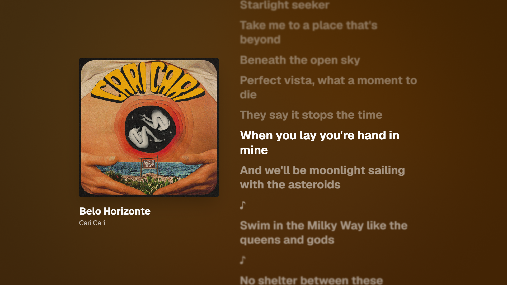
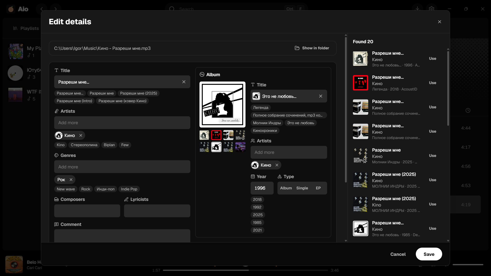

  

<h1 align="center">Aio</h1>

  A desktop music player for your own library, built with Tauri, Rust and React.
   
  <a href="https://github.com/piscopancer/aio/releases/latest"><b>Download for Windows</b></a>

  

  
  
  

## Features

Aio reads the folders you point it at and sorts the songs into Folders, Artists, Albums and Songs by their tags. It plays MP3, FLAC, Ogg, Opus, M4A, WAV, AIFF, WavPack and APE, resumes where it stopped after a restart, and updates itself quietly in the background.

Playlists sit in a sidebar that narrows down to covers. Songs are added by dragging them onto a playlist, and a search on Ctrl F looks through the whole library at once.

Synced lyrics from LRCLIB follow the song line by line, in a side panel or over the whole screen.

The tag editor looks the song up on MusicBrainz, Deezer, iTunes, Bandcamp and YouTube Music, or recognises it by sound through AcoustID, so tags and covers are filled in with a click.

New songs can be downloaded from YouTube, YouTube Music and Spotify links straight into the library, already tagged.
